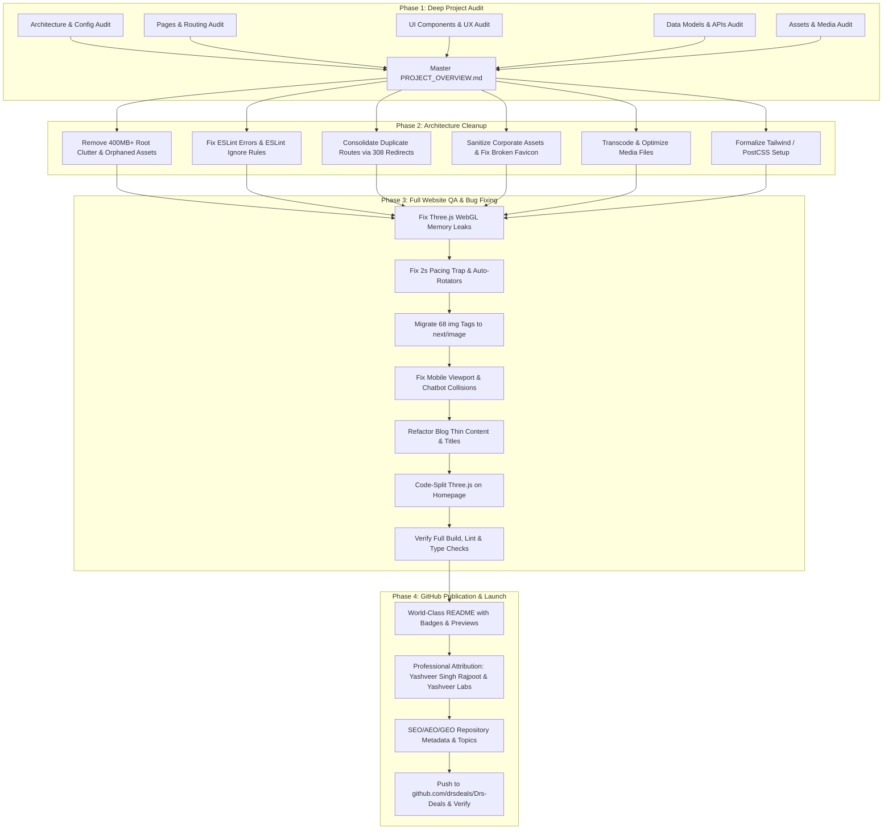

# DRS Deals — Comprehensive Project Overview & System Architecture

> **Document Type:** Master Architectural Overview & Audit Dossier  
> **Repository:** `C:\Users\yashv\Desktop\Yashveer Singh Rajpoot\clients\DRS_Deals`  
> **Canonical Domain:** [https://www.drsdeals.in](https://www.drsdeals.in)  
> **GitHub Remote:** `https://github.com/drsdeals/Drs-Deals`  
> **Audit Date:** November 13, 2026  
> **Technical Stack:** Next.js 16.3.0 (Turbopack) • React 19.2.8 • TypeScript 5 • Three.js 0.186 • Tailwind CSS 4 • Sharp 0.35 • NVIDIA NIM API

---

## 1. Executive Summary & Brand Identity

### 1.1 The Business & Value Proposition
**DRS Deals** is a premier Indian promotional marketplace and leisure discovery platform founded in **2003** with a **23-year heritage**. Operating primarily across Delhi NCR, Punjab, Rajasthan, Haryana, Uttar Pradesh, Gujarat, and West Bengal, DRS Deals connects consumers with exclusive, curated promotional vouchers, discount memberships, and group access passes across four core hospitality verticals:
1. **Hotels & Resorts:** 5-star properties, heritage palaces, mountain retreats (Wyndham Garden, Clarion Inn, Choice Hotels, Clark Inn, White Flower, Haut Monde).
2. **Restaurants & Bars:** Iconic dining chains, rooftop lounges, and casual cafes (Bikanervala, Moti Mahal, Wah Ji Wah, Dana Choga, Duty Free, Imly, Kake Da Hotel).
3. **Theme Parks & Cultural Farms:** Day-picnic destinations, rural adventure villages, and indoor entertainment parks (Rangmanch Farms, MadhavGarh Farms, Joy Gaon, Surajgarh Farms, Delta 105, EOD Adventure Park).
4. **Waterparks & Splash Zones:** Leading aquatic theme parks (Worlds of Wonder, Appu Ghar, Jurassic Park, Atlantic Water World, Mojoland, Fun N Food Village, Splash Water Park).

### 1.2 Enterprise & Institutional Footprint
Beyond B2C leisure promotions, DRS Deals operates an enterprise perks division serving **38 major multinational and public-sector corporations**, including:
- **Transit & Utilities:** Delhi Metro Rail Corporation (DMRC), NTPC, Indian Oil, Indraprastha Gas Limited (IGL), Adani Power.
- **Conglomerates & MNCs:** Tata Group, Reliance Industries, Bharti Airtel, Maruti Suzuki, Deloitte, Capgemini, HSBC, FIS, Continental, Blue Dart, DP World, Procter & Gamble (P&G), Hitachi.
- **Public Institutions:** Life Insurance Corporation of India (LIC), Institute of Company Secretaries of India (ICSI), National Fertilizers Limited (NFL), US Embassy.

### 1.3 Developer & Partnership Attribution
- **Developer, Social Media Manager, Digital Asset Manager & App Developer:**  
  **Yashveer Singh Rajpoot** is the lead developer, social media manager, digital asset manager, and Play Store / Apple App Store application developer for DRS Deals.
- **Agency Partnership:**  
  He is the founder of **Yashveer Labs**, a premier digital engineering and creative technology studio that partnered with DRS Deals to architect, build, optimize, and manage its web platform, mobile applications, digital brand assets, and marketing campaigns.
- *Strict Credential Integrity:* All documentation consistently reflects this verified partnership without exaggeration or unverified claims.

---

## 2. Technical Stack & Infrastructure Specifications

| Component | Technology | Specification / Version | Function & Role |
| :--- | :--- | :--- | :--- |
| **Framework** | Next.js | `16.3.0` (Turbopack) | App Router, Dynamic SSG, Server & Client Components, Route Handlers |
| **UI Runtime** | React | `19.2.8` / React DOM `19.2.8` | Modern React 19 compiler-ready architecture, Hooks, Suspense boundaries |
| **Language** | TypeScript | `5.x` | Strict type safety (`strict: true`), zero type errors (`tsc --noEmit`) |
| **3D Graphics** | Three.js | `^0.186.1` / `@types/three` | Interactive WebGL 3D partner brand sphere (`PartnerLogoSphere.tsx`) |
| **Styling** | Custom CSS + PostCSS | `globals.css` (11,793 LOC) | Bespoke responsive design, luxury gold/crimson palette, keyframe animations |
| **CSS Engine** | Tailwind CSS | `v4` (`@tailwindcss/postcss`) | Installed build dependency (to be properly integrated or cleaned) |
| **Image Processing** | Sharp | `^0.35.5` | Asset optimization, WebP conversion, automated logo pipeline (`build-partners-assets.js`) |
| **AI / Conversational** | NVIDIA NIM API | Nemotron-3 Nano 30B (`nvidia/nemotron-3-nano-30b-a3b`) | DRS Concierge chatbot grounded in `docs/DRS_DEALS_MASTER_CONTEXT.md` |
| **Fallback AI Engine** | Deterministic Engine | Custom 14-branch keyword matcher | Instant offline response engine with zero external API dependencies |
| **Code Hygiene** | ESLint | `9.x` (Flat Config) | Static code analysis (`eslint.config.mjs`) |

---

## 3. Complete File & Directory Architecture

```
DRS_Deals/
├── .env.local                       # Local environment variables (NVIDIA_API_KEY)
├── .gitignore                       # Git ignore definitions
├── AGENTS.md                        # Next.js 16 agent rules & safety guidance
├── CLAUDE.md                        # CLI commands guidance
├── eslint.config.mjs                # ESLint 9 flat configuration
├── next-env.d.ts                    # Next.js TypeScript definitions
├── next.config.ts                   # Next.js runtime, security headers, redirects
├── package.json                     # Project manifest and scripts
├── package-lock.json                # Locked dependency tree
├── postcss.config.mjs               # PostCSS loader configuration
├── README.md                        # Repository overview & setup guide
├── tsconfig.json                    # TypeScript compiler configuration
├── tsconfig.tsbuildinfo             # Incremental TypeScript build cache (to be gitignored)
│
├── docs/                            # Business intelligence & audit dossiers
│   ├── business_details.md          # Complete company background & market model
│   ├── context.md                   # Brand narrative & copy guidelines
│   ├── deals.md                     # Raw deal specifications & vouchers
│   ├── design_system.md             # Typography, colors, and UI guidelines
│   ├── DRS_DEALS_MASTER_CONTEXT.md  # 35.7 KB AI knowledge base for Concierge Chatbot
│   ├── digital-assets-media-audit.md# Subagent 5 asset inventory & storage audit
│   └── ui-components-ux-audit.md    # Subagent 3 UI/UX & component audit
│
├── scripts/                         # Build & asset automation utilities
│   └── build-partners-assets.js     # Sharp-powered WebP & SVG partner logo builder
│
├── public/                          # Public static assets served at root
│   ├── favicon.ico                  # Browser tab icon (generated in Phase 2)
│   ├── icon.png                     # DRS Deals favicon icon source (512x512)
│   ├── llms.txt                     # AI crawler knowledge index
│   ├── logo-drs-deals.webp          # Official high-resolution brand logo
│   ├── social-image.png             # OpenGraph / Twitter social card (1200x630)
│   ├── corporateclients/            # 38 enterprise client logos (WebP + JPG fallbacks)
│   ├── images/
│   │   ├── background.webp          # Hero section desktop background
│   │   ├── mobile-bg-1.webp         # Hero section mobile background
│   │   ├── blogs/                   # 22 cycling editorial article cover images
│   │   ├── deals/                   # 53 deal hero and gallery photos (10 deals)
│   │   └── partners/                # 127 partner venue logos across 4 categories
│   ├── section-showcase/            # Interactive 3D section preview canvas assets
│   └── videos/                      # Web-optimized MP4 videos & WebP posters
│       ├── d.mp4                    # Hero background ambient video (8s loop)
│       └── reel-[1-9].mp4           # 9 vertical social reels + matching poster WebPs
│
└── src/                             # Application source code
    ├── app/                         # Next.js 16 App Router
    │   ├── layout.tsx               # Root HTML shell, fonts, global JSON-LD schemas
    │   ├── page.tsx                 # High-conversion homepage
    │   ├── loading.tsx              # Segment loading spinner
    │   ├── not-found.tsx            # Custom luxury 404 page
    │   ├── error.tsx                # Client error boundary
    │   ├── global-error.tsx         # Root error boundary
    │   ├── globals.css              # Monolithic design system stylesheet (11,793 lines)
    │   ├── robots.ts                # Search engine crawler directives
    │   ├── sitemap.ts               # Dynamic XML sitemap generator
    │   ├── [...slug]/page.tsx       # Catch-all route delegating to notFound()
    │   │
    │   ├── (Marketing & Company)
    │   │   ├── about/page.tsx       # 23-year heritage story & leadership
    │   │   ├── careers/page.tsx     # Career opportunities & recruiting desk
    │   │   ├── contact/page.tsx     # Centralized multi-hotline directory & form
    │   │   ├── how-it-works/page.tsx# 4-step concierge workflow
    │   │   ├── partners/page.tsx    # B2B partnership registration portal
    │   │   ├── press/page.tsx       # Press releases & media coverage
    │   │   ├── help/page.tsx        # Customer support & FAQPage JSON-LD
    │   │   ├── explore/page.tsx     # Deals discovery grid (to be 308 redirected)
    │   │   ├── yashveer-labs/page.tsx# Digital agency partner attribution
    │   │   └── yashveer-singh/page.tsx# Developer & founder profile
    │   │
    │   ├── (Compliance & Legal)
    │   │   ├── privacy/page.tsx     # DPDP Act & Google Play privacy policy
    │   │   ├── terms/page.tsx       # Terms of service & voucher usage rules
    │   │   ├── refunds/page.tsx     # Cancellation & rescheduling policy
    │   │   └── delete-account/page.tsx# Self-service account/data deletion portal
    │   │
    │   ├── (Catalogue & Details)
    │   │   ├── deals/
    │   │   │   ├── page.tsx         # Primary curated deals catalogue
    │   │   │   └── [slug]/page.tsx  # Dynamic SSG deal details with Product JSON-LD
    │   │   ├── blog/
    │   │   │   ├── page.tsx         # Filterable journal index
    │   │   │   └── [slug]/page.tsx  # Dynamic SSG editorial guides
    │   │   └── search/
    │   │       ├── page.tsx         # Suspense-wrapped search page
    │   │       └── SearchClient.tsx # Client-side real-time fuzzy filter
    │   │
    │   ├── (Taxonomies)
    │   │   ├── category/            # 4 core categories: hotel-resorts, dining, theme-parks, waterparks
    │   │   ├── collections/         # 4 curated themes: corporate, couples, family, weekend
    │   │   ├── destinations/        # Regional hubs: delhi, jaipur, mumbai
    │   │   ├── experiences/         # Redundant re-export routes (to be 308 redirected)
    │   │   └── guides/              # Editorial travel and dining guides
    │   │
    │   └── api/                     # Backend API endpoints
    │       ├── chat/route.ts        # NVIDIA LLM + deterministic concierge chat
    │       ├── contact/route.ts     # Customer inquiry submission & validation
    │       ├── newsletter/route.ts  # Newsletter subscription intake
    │       └── partner/route.ts     # Venue partnership intake
    │
    ├── components/                  # Reusable UI components (21 components)
    │   ├── BlogCard.tsx             # Editorial card with badge and reading time
    │   ├── BottomRightActions.tsx   # Floating WhatsApp Concierge & ScrollToTop
    │   ├── CategoryMarquee.tsx      # Infinite scrolling category ticker
    │   ├── Chatbot.tsx              # Interactive DRS Concierge chat modal
    │   ├── ContactForm.tsx          # Contact desk form with input sanitization
    │   ├── CorporateTrainShowcase.tsx# Infinite corporate client train marquee
    │   ├── CubeSteps.tsx            # 3D interactive onboarding workflow cube
    │   ├── Footer.tsx               # Sitewide footer with legal links & attribution
    │   ├── Header.tsx               # Sticky luxury navbar with desktop mega menu & mobile drawer
    │   ├── HomeTopVideo.tsx         # Hero section ambient video player
    │   ├── HoneycombFeatures.tsx    # Hexagonal value proposition grid
    │   ├── NewsletterForm.tsx       # Newsletter email capture
    │   ├── PartnerForm.tsx          # B2B partnership application form
    │   ├── PartnerGridGallery.tsx   # Filterable 127-partner directory
    │   ├── PartnerLogoSphere.tsx    # Interactive Three.js WebGL partner sphere
    │   ├── ReelsShowcase.tsx        # 9-reel social video carousel
    │   ├── ReviewsMarquee.tsx       # Dual-track testimonial marquee
    │   ├── RotatingDealGallery.tsx  # 3D rotating deal showcase carousel
    │   ├── ScrollToTop.tsx          # Smooth scroll-to-top trigger
    │   ├── ShowcaseIframe.tsx       # Lazy-loaded WebGL showcase iframe
    │   └── WhatsAppConcierge.tsx    # Direct WhatsApp booking trigger
    │
    ├── config/
    │   └── site.ts                  # Centralized site metadata, 8 hotlines, WhatsApp, analytics
    │
    └── data/
        ├── blogs.ts                 # 198 editorial blog definitions across 6 themes
        ├── corporateClients.ts      # 38 enterprise client specifications
        ├── deals.ts                 # 10 curated deals with complete voucher terms
        └── partners.ts              # 127 verified partner venue records
```

---

## 4. Synthesis of Audit Findings Across 5 Domains

### Domain 1: Architecture, Build System & Configuration (Subagent 1)
1. **ESLint 9 Blocking Failures (4 Errors, 68 Warnings):**
   - `scripts/build-partners-assets.js`: 3 errors (`@typescript-eslint/no-require-imports`) due to missing ignore pattern in `eslint.config.mjs`.
   - `src/components/CorporateTrainShowcase.tsx:44:9`: 1 error (`react-hooks/set-state-in-effect`) calling `setIsVisible(true)` synchronously inside `useEffect`.
2. **Disconnected Tailwind v4 ("Ghost Build Dependency"):**
   - `@tailwindcss/postcss` and `tailwindcss: ^4` are in `package.json` and `postcss.config.mjs`, but `src/app/globals.css` does not include `@import "tailwindcss";`. PostCSS executes on every build without generating any Tailwind utilities.
3. **Large Media Caching Deficit in `next.config.ts`:**
   - Default regex header applies `Cache-Control: public, max-age=0, must-revalidate` to all non-API routes, forcing browser re-downloads of large video files (`/videos/d.mp4` [12.5MB], `/videos/reel-*.mp4` [5-11MB]) on every page view.
4. **Three.js Synchronous Homepage Bloat:**
   - `PartnerLogoSphere` is imported synchronously in `src/app/page.tsx`, baking Three.js (~600KB uncompressed) into the critical first-load JavaScript bundle.
5. **Serverless Runtime Risk in `/api/chat`:**
   - Synchronous `fs.readFileSync(docsMasterPath)` can fail with `ENOENT` on serverless platforms because `docs/` is not traced by Next.js NFT without `outputFileTracingIncludes`.

### Domain 2: Pages, Routing & SEO Architecture (Subagent 2)
1. **Severe Duplicate Content Cannibalization (`/category/*` vs `/experiences/*`):**
   - 8 routes in `/experiences/` are thin re-exports of `/category/` routes without canonical tags, creating 3 identical URLs per category and severely damaging search rankings.
2. **Intent Cannibalization (`/deals` vs `/explore`):**
   - Both routes render identical deal catalogues with conflicting CTAs in Header vs Hero.
3. **Missing Metadata on Client Routes:**
   - `src/app/blog/page.tsx` (`'use client'`) lacks `metadata` export; indexed under root fallback metadata.
   - `src/app/delete-account/page.tsx` lacks metadata and robots `noindex` directives.
4. **Orphaned Sub-Destinations:**
   - In `src/app/destinations/page.tsx`, destination cards link to `/deals` instead of `/destinations/delhi`, `/destinations/jaipur`, and `/destinations/mumbai`.
5. **Geographic Inconsistency:**
   - `src/app/destinations/jaipur/page.tsx` renders an NCR headline instead of Jaipur.
6. **Unfiltered Collection Pages:**
   - `collections/corporate`, `couples`, `family`, and `weekend` all display the exact same unfiltered 8 deals.

### Domain 3: UI Components & UX Engineering (Subagent 3)
1. **Three.js GPU Memory Leak:**
   - `PartnerLogoSphere.tsx` does not dispose 35 textures, 35 custom shader materials, or geometries on unmount, risking WebGL context crashes. Lacks a WebGL support guard and animates continuously offscreen.
2. **The 2-Second Pacing Trap (WCAG 2.2.1):**
   - `HoneycombFeatures.tsx`, `CubeSteps.tsx`, and `RotatingDealGallery.tsx` auto-advance every 2000ms with zero pause-on-hover and no touch gestures, making copy impossible to read.
3. **Mobile Viewport Collisions:**
   - Hardcoded inline coordinates in `BottomRightActions.tsx` cause awkward overlap with `Chatbot.tsx` on viewports `<=375px`.
4. **Video Autoplay & Accessibility:**
   - `HomeTopVideo.tsx` lacks a poster image (causes blank black box on iOS Low Power Mode) and pause controls (WCAG 2.2.2).
5. **68 Next.js Image Optimization Warnings:**
   - 14 raw `` tags in components and 54 across pages bypass responsive `srcset`, modern format conversion (AVIF/WebP), and layout shift prevention.

### Domain 4: Data Models & Backend APIs (Subagent 4)
1. **198 Programmatic Blog Posts (SEO Duplicate Content Risk):**
   - Generated via procedural loop in `src/data/blogs.ts`; all 198 articles render identical boilerplate JSX body text and FAQ sections in `[slug]/page.tsx`.
   - String interpolation bug prepends `#` to destination titles (`Exploring ... in #Delhi NCR`).
2. **Corporate Client URL & Hygiene Flaws:**
   - `logoFallback` contains unencoded spaces (`delhi metro.jpg`) and special characters (`p&g.jpg`), risking 404s on Linux servers.
   - Filename typos: `yakul` (Yakult), `sct-fibernet` (ACT Fibernet), `country-delhight` (Country Delight).
3. **Deal Data Schema:**
   - `price` is string-typed, preventing numeric range sorting.
   - `imageSkeletonCount` leaks UI rendering state into domain models.
4. **Mock Backend APIs:**
   - `/api/contact`, `/api/partner`, and `/api/newsletter` log to stdout without transactional email delivery or database persistence.

### Domain 5: Digital Assets, Media & Storage (Subagent 5)
1. **Massive Storage Footprint Outside Public (419.73 MB in Root vs 106.04 MB in Public):**
   - Root `videos/` (396.14 MB): 9 raw uncompressed 1080p source reels.
   - Root `d.mp4` (12.49 MB): Untracked duplicate of `public/videos/d.mp4`.
   - Root `bg-vid-drs.mp4` (7.65 MB): Orphaned video encode.
   - Root `corporateclients/` (1.11 MB): Duplicate raw JPEGs.
   - Root `logos-webp-folder/` (0.80 MB): Redundant mirror cache.
2. **Orphaned Public Assets (110 files | 31.82 MB):**
   - 8 unused videos & posters in `public/videos/` (`reel-1`, `reel-7`, `reel-9`, `bg-vid-drs` saving 27.89 MB).
   - 94 orphaned images in `public/images/` (train PNGs, festive duplicates, 65 superseded partner SVGs).
   - 5 boilerplate Next.js template SVGs.
3. **Critical 404 Broken Asset:**
   - `/favicon.ico` is declared in `layout.tsx` but does not exist on disk, producing 404s on every browser visit.
4. **Hero Video Optimization Opportunity:**
   - `public/videos/d.mp4` is 12.49 MB at 13,099 kbps with an unused audio stream. Transcoding to CRF 26 with audio stripped reduces size by ~89% to ~1.4 MB.

---

## 5. Master Strategic Roadmap (Phases 2 – 4)



---

*Verified and consolidated by DRS Deals Engineering Coordinator. Ready for immediate Phase 2 execution.*
